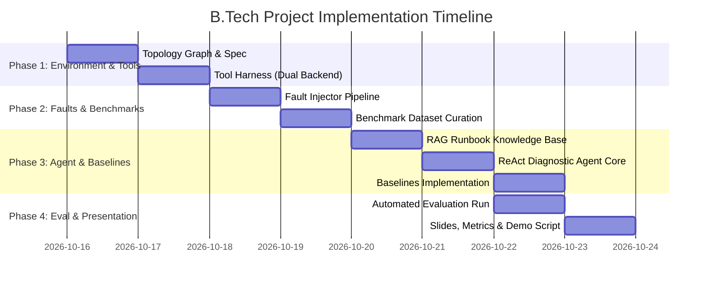

# Project Workflow & Implementation Roadmap

**Project Title:** Topology-Aware Tool-Using LLM Agent for Automated Network Fault Diagnosis and Root-Cause Analysis  
**Academic Context:** IT-401 B.Tech Project-I • Delhi Technological University (DTU)  
**Supervisor:** Dr. Anamika Chauhan  
**Team Details (Group No. 067):**
- Harshit Vaish (23/IT/067)
- Harshvardhan Kumar Arya (23/IT/068)
- Ishaan Yadav (23/IT/073)

---

## 1. High-Level Architectural Flow

```
                      +-----------------------------+
                      |       Fault Injector        |
                      |  (Mininet / NetEm / Python) |
                      +--------------+--------------+
                                     |
                             [Injected State]
                                     v
+------------------+      +--------------------+      +--------------------+
|  Topology Graph  | ---> |  Diagnostic Agent  | <--> | Diagnostic Harness |
| (topology.json)  |      |   (ReAct Loop)     |      |  (network_tools)   |
+------------------+      +---------+----------+      +---------+----------+
                                    |                           |
                          [Hypothesis & Actions]         [CLI Telemetry]
                                    |                           |
                                    +-------------+-------------+
                                                  |
                                                  v
                                      +-----------------------+
                                      | Synthesized RCA Report|
                                      |  - Root Cause Match   |
                                      |  - Actionable Command |
                                      +-----------------------+
```

---

## 2. Dual-Mode Execution Strategy (Windows vs. Linux Mininet)

Because the development environment is **Windows** while Mininet and Linux namespaces (`ip netns`, `tc netem`, Open vSwitch) require a Linux kernel, the architecture adopts a **Dual-Mode Adapter**:

| Feature | Mode A: Simulated Python Sandbox (Windows Native) | Mode B: Live Mininet Driver (Linux / WSL2 / VM) |
| :--- | :--- | :--- |
| **Primary Use** | Rapid local development, unit testing, prompt engineering, baseline evaluation | Final live evaluation, mid-term terminal demonstration |
| **Dependencies** | Python 3.10+ (Standard library, NetworkX, pydantic) | Ubuntu 22.04 LTS, Mininet, Open vSwitch, iproute2, NetEm |
| **Command Execution** | In-memory state machine intercepts CLI syntax and returns real-looking terminal logs | Subprocess shell execution inside node namespaces (`ip netns exec <node> <cmd>`) |
| **Compatibility** | 100% Windows compatible with zero external drivers | Exact same API calls as Mode A via interface abstraction |

---

## 3. Four-Phase Detailed Roadmap



---

### Phase 1: Virtual Network Sandbox & Diagnostic Tool Harness
**Target Duration:** Day 1 – Day 2  

#### Objectives:
1. Formalize topology configuration (2 switches, 4 hosts, 1 gateway).
2. Build standardized tool wrappers catching `stdout`, `stderr`, and handling timeouts.
3. Establish uniform execution interfaces for both Windows-simulated and Linux-live environments.

#### Key Modules to Build:
- `topology.json`: JSON graph containing nodes (`h1`, `h2`, `h3`, `h4`, `s1`, `s2`, `gw1`), interfaces, subnets (`10.0.0.0/24`, `10.0.1.0/24`), MAC addresses, and physical port interconnections.
- `src/tools/network_tools.py`:
  - `ping_tool(src_node, target_ip, count=3, timeout=5)`
  - `traceroute_tool(src_node, target_ip, max_hops=8, timeout=6)`
  - `routing_table_tool(node_id)` (`ip route show`)
  - `interface_stats_tool(node_id)` (`ip -s link`)
  - `dns_query_tool(src_node, hostname)` (`nslookup / dig`)
- `src/sandbox/network_sandbox.py`: State engine managing nodes, link states, routing tables, and mock execution outputs on Windows.

#### Exit Criteria:
- Calling `ping_tool("h1", "10.0.0.4")` returns valid ICMP statistics with calculated RTT.
- If a link or route is marked down, subsequent tool calls reflect packet drops or "Destination Host Unreachable".

---

### Phase 2: Fault Injection Pipeline & Benchmark Dataset
**Target Duration:** Day 3 – Day 4  

#### Objectives:
1. Implement programmatic fault injection covering 5 distinct failure archetypes across L1 through L7.
2. Build an automated benchmark suite with deterministic ground truth.

#### 5 Fault Archetypes:
1. **Link State Failure (L1/L2)**
   - *Mechanism:* Trunk port link down.
   - *Command:* `ip link set dev s1-eth2 down`
   - *Signature:* 100% packet loss, interface state flagged `DOWN`.
2. **Routing Blackhole (L3)**
   - *Mechanism:* Erroneous or stripped default gateway.
   - *Command:* `ip route del default via 10.0.0.1`
   - *Signature:* `connect: Network is unreachable` or silent drop.
3. **Channel Impairment / QoS (L3/L4)**
   - *Mechanism:* Severe synthetic jitter and packet degradation via NetEm.
   - *Command:* `tc qdisc add dev s1-eth1 root netem loss 35% delay 180ms`
   - *Signature:* High RTT variance, erratic ping drop rate.
4. **Name Resolution Failure (L7)**
   - *Mechanism:* Misconfigured DNS resolver IP.
   - *Command:* Corrupting nameserver IP in `/etc/resolv.conf`.
   - *Signature:* Direct IP ping works, hostname lookup times out.
5. **Interface State / MTU Mismatch**
   - *Mechanism:* Subnet MTU mismatch leading to oversized packet drops.
   - *Command:* `ip link set dev h1-eth0 mtu 1200`
   - *Signature:* Small ping succeeds; DF-flagged large frames fail.

#### Key Modules to Build:
- `src/faults/fault_injector.py`: Methods `inject_link_failure()`, `inject_routing_blackhole()`, `inject_channel_impairment()`, `inject_dns_failure()`, `reset_network()`.
- `benchmarks/benchmarks.json`: Standardized dataset containing 10–15 curated scenarios.

```json
[
  {
    "scenario_id": "NET-SCN-001",
    "fault_class": "Interface State",
    "symptom": "Host h1 unable to reach application service at Host h4 (10.0.0.4)",
    "injected_fault": "Switch s1 port eth3 administrative down",
    "ground_truth_root_cause": "Port s1-eth3 is DOWN; inter-switch trunk severed.",
    "remediation": "ip link set dev s1-eth3 up"
  }
]
```

#### Exit Criteria:
- Running `python fault_injector.py --inject NET-SCN-001` cleanly alters the state.
- `benchmarks.json` validated against Pydantic schema with deterministic ground truths.

---

### Phase 3: ReAct Reasoning Loop, Topology Awareness & Baselines
**Target Duration:** Day 5 – Day 6  

#### Objectives:
1. Build the cognitive ReAct loop (`Thought` $\rightarrow$ `Action` $\rightarrow$ `Observation` $\rightarrow$ `Conclusion`).
2. Supply dynamic network topology context to eliminate phantom link hallucinations.
3. Integrate domain runbook knowledge using lightweight RAG.
4. Implement baseline systems for comparative evaluation.

#### Key Modules to Build:
- `src/agent/diagnostic_agent.py`:
  - Enforces prompt constraints:
    1. Formulate explicit hypothesis before calling a tool.
    2. Hard cap at 6 tool invocations maximum per scenario.
    3. Prohibit recommending hardware replacements for software/config errors.
  - LLM backend adapter supporting OpenAI / Gemini / Ollama / Groq / Anthropic.
- `src/rag/runbook_retriever.py`:
  - Curated runbooks (`data/runbooks/`): ICMP triage, routing table interpretation, interface flags, DNS debugging.
  - Embedding and retrieval mechanism using FAISS or BM25/keyword retrieval.
- `src/baselines/`:
  - `baseline_zero_shot.py`: Unassisted LLM given symptom + topology description, 0 tools.
  - `baseline_rag.py`: LLM given symptom + retrieved runbook entries, 0 tools.

#### Exit Criteria:
- Agent sequentially diagnoses `NET-SCN-001` within $\le 4$ tool calls without crashing or hallucinating non-existent interfaces.

---

### Phase 4: Empirical Evaluation, Metrics & Mid-Term Presentation
**Target Duration:** Day 7  

#### Objectives:
1. Benchmark all scenarios across all 3 systems (Zero-Shot, RAG, Proposed Agent).
2. Generate comprehensive comparative evaluation tables.
3. Prepare live demonstration artifacts and presentation slides.

#### Evaluation Metrics:
| Metric | Zero-Shot LLM | Static RAG + LLM | Proposed Tool-Using Agent |
| :--- | :--- | :--- | :--- |
| **Fault Category Accuracy** | 40% – 50% | 65% – 70% | 85% – 95% (Target) |
| **Root Cause Precision** | Low (Generic) | Moderate (Runbook match) | High (Evidence-backed) |
| **Hallucination Rate** | High (>45% phantom links) | Moderate (20% – 30%) | Minimal (<5% tool-grounded) |
| **Avg. Invocations / Run** | 0 tools | 0 tools | 3 to 5 targeted tool calls |
| **Actionable Remediation** | Generic advice | Template text | Exact CLI syntax command |

#### Key Modules & Deliverables:
- `evaluator.py`: Iterates over `benchmarks.json`, runs all 3 configurations, and exports `results/evaluation_metrics.json` and a formatted Markdown report.
- `demo.py`: Clean terminal demonstration script with colored step-by-step traces.
- `presentation/midterm_slides.md`: 9-slide deck mapped directly to the DTU evaluation criteria.

---

## 4. Directory Structure

```
project/
├── WORKFLOW.md                       <-- This document
├── README.md                         <-- Setup & project overview
├── config/
│   ├── topology.json                 <-- 2 switches, 4 hosts, 1 gateway topology
│   └── agent_config.yaml             <-- Model parameters, tool limits, prompts
├── benchmarks/
│   └── benchmarks.json               <-- Curated scenarios with ground truth
├── data/
│   └── runbooks/                     <-- Markdown runbooks for RAG retrieval
│       ├── icmp_troubleshooting.md
│       ├── routing_triage.md
│       └── dns_resolution.md
├── src/
│   ├── __init__.py
│   ├── sandbox/                      <-- Network environment backends
│   │   ├── __init__.py
│   │   ├── network_sandbox.py        <-- Windows simulated network engine
│   │   └── mininet_driver.py         <-- Linux/WSL Mininet driver
│   ├── tools/                        <-- Standardized diagnostic tool harnesses
│   │   ├── __init__.py
│   │   └── network_tools.py
│   ├── faults/                       <-- Fault injection mechanisms
│   │   ├── __init__.py
│   │   └── fault_injector.py
│   ├── rag/                          <-- Domain knowledge retrieval
│   │   ├── __init__.py
│   │   └── runbook_retriever.py
│   ├── agent/                        <-- ReAct tool-calling core
│   │   ├── __init__.py
│   │   ├── diagnostic_agent.py
│   │   └── prompt_templates.py
│   └── baselines/                    <-- Benchmark comparison models
│       ├── __init__.py
│       ├── baseline_zero_shot.py
│       └── baseline_rag.py
├── scripts/
│   ├── run_eval.py                   <-- Comprehensive evaluation runner
│   └── demo.py                       <-- Live interactive terminal demo
├── results/                          <-- Generated benchmarking artifacts
└── tests/
    ├── test_tools.py
    └── test_sandbox.py
```

---

## 5. Actionable Implementation Checklist

- [x] **Step 1: Core Scaffolding**
  - Create directory structure.
  - Add `requirements.txt` (`pydantic`, `networkx`, `colorama`, etc.).
- [x] **Step 2: Topology & Network Sandbox**
  - Implement `topology.json` (2 switches, 4 hosts, 1 gateway).
  - Implement `src/sandbox/network_sandbox.py` (Windows state engine).
  - Implement `src/tools/network_tools.py` with diagnostic wrappers.
- [x] **Step 3: Fault Injection & Benchmarks**
  - Implement `src/faults/fault_injector.py` (5 fault archetypes).
  - Populate `benchmarks/benchmarks.json` with 10 verified scenarios.
- [x] **Step 4: RAG Runbooks & Knowledge Base**
  - Write network triage runbooks in `data/runbooks/`.
  - Implement retriever in `src/rag/runbook_retriever.py`.
- [x] **Step 5: Diagnostic Agent & Baselines**
  - Implement ReAct agent with tool execution in `src/agent/diagnostic_agent.py`.
  - Implement `baseline_zero_shot.py` and `baseline_rag.py`.
- [x] **Step 6: Evaluation & Packaging**
  - Run benchmark evaluations across all scenarios.
  - Generate final metrics table.
  - Build live CLI demo script (`scripts/demo.py`).
